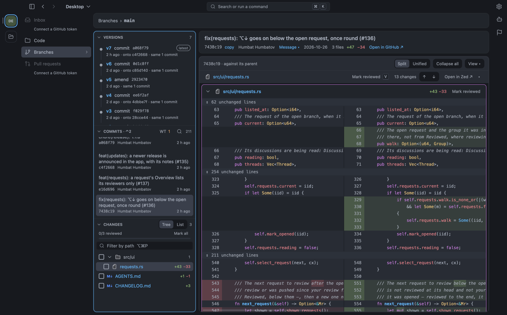
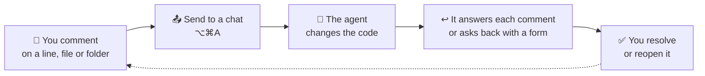

<div align="center">


# GitLance

**Review commits, branches, merge requests and what your coding agent changed — in one desktop app.**<br>
No IDE to open, no worktrees to create.

[](https://github.com/Thernal/gitlance-desktop/releases/latest)
[](https://github.com/Thernal/gitlance-desktop/actions/workflows/ci.yml)


[](LICENSE)

[**Download**](https://github.com/Thernal/gitlance-desktop/releases/latest) ·
[What's new](CHANGELOG.md) ·
[Report a problem](https://github.com/Thernal/gitlance-desktop/issues/new)

</div>



## At a glance

| | | What you can do |
|:-:|---|---|
| 🔍 | **Review any diff** | a commit, a branch, the working tree or any two revisions — every file in one scroll, each marked reviewed as you go |
| 🔀 | **Merge and pull requests** | GitLab's and GitHub's, grouped by what each needs from you; discuss on the lines, approve, submit a review, create one |
| 🕘 | **Versions of a branch** | after an amend, a rebase or a force push: what changed between two versions, without the rebase's noise |
| 🤖 | **Comments for your agent** | write them on lines, files or folders; Claude Code or Codex changes the code and answers each one |
| 📥 | **Inbox** | mentions, review requests, replies and your agents' answers in one list, answered in place |
| 🗂️ | **Code** | the project's tree at the working tree, a branch or a commit; files open as tabs, Markdown rendered |
| 🎨 | **Made yours** | five themes and your own, every key rebindable (GitLance, Android Studio or VS Code keys), zoom |

GitLance only reads your repository: it never stages, commits or checks out ([what it writes](#in-detail)).

## Works with

| | |
|---|---|
| **Code hosts** | GitLab (gitlab.com and self-managed) · GitHub (github.com and Enterprise) |
| **Coding agents** | Claude Code · Codex (limited) |
| **Systems** | macOS 12+ (Apple silicon and Intel) · Windows x64 · Linux x86_64 (X11 and Wayland) |

## Install

Download the file for your system from the [latest release](https://github.com/Thernal/gitlance-desktop/releases/latest):

| System | File | |
|---|---|---|
| macOS | `GitLance-<v>-macos.dmg` (or `.zip`) | drag GitLance to Applications |
| Windows | `GitLance-<v>-windows-x64.zip` | unzip, run `GitLance.exe` |
| Linux | `GitLance-<v>-x86_64.AppImage` | `chmod +x`, then run it — or the `.tar.gz` with a desktop file |

> [!NOTE]
> The builds are not signed yet. **macOS** refuses the first open: right-click the app → Open, or System
> Settings → Privacy & Security → Open Anyway (or `xattr -dr com.apple.quarantine /Applications/GitLance.app`).
> **Windows** SmartScreen asks: More info → Run anyway.

GitLance tells you when a newer release is out, with what is new in it; it downloads nothing by itself
(Settings → General → Check for updates).

## Your agent in the loop



Comments for your agent are purple and stay on your machine; comments on a merge request are orange and go to
GitLab or GitHub. Several chats can work at once, each in its own worktree — a note goes to the chat working on
its branch.

## Merge requests, by what they need from you

| 🔵 Needs your review | 🟠 Updated since your review | ⚪ New | 🟢 Reviewed | 👤 Yours |
|---|---|---|---|---|
| you are asked to review it, or started | pushed since you marked its files — see only what changed | not asked of you, not read yet | its head is reviewed | opened by you |

⌥↓ opens the next one waiting for you. Merged and closed requests are a click away.

## In detail

<details>
<summary><b>🧭 Spaces and navigation</b></summary>

Four spaces in the menu on the left (⌃⌘1…4), each keeping the page it was left on:

| Space | What is in it |
|---|---|
| **Inbox** ⌘⇧N | GitLab to-dos or GitHub notifications, new replies where you wrote, your discussions resolved by someone else, your agents' answers — All · Mentions · Agents · Reviews. Reply (r), resolve, mark done (e) in place. |
| **Code** | the project's tree at the working tree, `HEAD`, a branch or a commit. Files and folders open as tabs; a file is highlighted, Markdown rendered. A folder that is not a git repository opens too. |
| **Branches** | the working tree's changes first, then local branches with ahead / behind the main line and their request. A branch opens as Commits · Changes since it forked. |
| **Merge requests** | the groups above; a request opens as Overview · Commits · Changes. |

Several repositories at once — a rail of projects, tabs in the title bar or projects in the menu (⌘T, ⌘1…9);
the session comes back on the next start, and a project can have its own name and colour. ⌘K searches
everything (files ⌘P, commits ⌘⇧C, branches ⌘⇧B, requests ⌘⇧R, actions ⌘⇧P); a pasted GitLab or GitHub link
opens in the app. ⌘[ ⌘] go back and forward through every page seen, esc goes one page up.

</details>

<details>
<summary><b>🔍 Reviewing a diff</b></summary>

- Every file in one scroll, or one file at a time (⌥A). **v** marks a file reviewed and moves to the next
  unread one; marks are kept per commit, range or request and reset when the file changes.
- View options, in the toolbar and the View menu, remembered between runs:

  | Option | Key | |
  |---|---|---|
  | Split · Unified | ⌥U | side by side, or one column |
  | Lines · Words · Structural | ⌥D | git's line diff, changed words marked, or [difftastic](https://difftastic.wilfred.me.uk)'s syntax-aware diff (`brew install difftastic`) |
  | Wrap | ⌥Z | long lines wrap, or scroll sideways |
  | All lines | ⌥E | every unchanged line, or three around each change |
  | Hide whitespace | ⌥W | whitespace-only changes count as unchanged |

- The working tree against `HEAD` — staged, unstaged and untracked together — refreshed when a file changes.
- Any two revisions compared (⌥⌘C).
- Images as 2-up, Swipe or Onion skin; an SVG as image or source; a changed Markdown file rendered with its
  changed blocks marked.
- **Zen** (⌘.): the diff alone; ⌥⌘. shows one file at a time at a reading width.
- ⌘F finds in every file, ⌥⌘F in the whole diff, both with regular expressions; ⌥⌘B shows who wrote each line;
  ⌘⇧O lists the declarations; F3 bookmarks a line; lock and generated files fold.

</details>

<details>
<summary><b>🕘 Versions of a rewritten branch</b></summary>

When a branch — typically a single commit — was amended, rebased or force-pushed, GitLance lists its earlier
versions and diffs any two of them:

- an unchanged base: a plain diff between the two versions;
- a moved base (rebase): the two patches are compared, so upstream changes do not show up as noise.

Earlier versions come from the reflogs of the branch and its remote-tracking ref, so GitLance sees the
versions this machine has seen — its own amends and rebases, and every fetch. The background fetch, on for
every repository with a remote, is what brings other people's pushes in. Versions expire with the reflog
(90 days by default).

</details>

<details>
<summary><b>🔀 Merge and pull requests</b></summary>

- Discussions on the lines — replies, reactions, editing and deleting your own notes, resolving (⇧N ⇧P walk
  them, r replies, x resolves, e edits); `@` lists people and `:` lists emoji while you write.
- Pending comments and Submit review (⌘⇧↵): Comment, Approve (a), Request changes (GitLab 17+).
- The pipeline or checks, approvals, and the reviewers with where each stands.
- What changed since the version you viewed; a comment written on an earlier version is drawn at its line now,
  with that line's history version by version.
- Creating one (⌥⌘M): the target's template, reviewers from CODEOWNERS, labels, milestone, draft, squash.

**Tokens.** GitLab needs one with the `api` scope (`read_api` to only read); GitHub a classic token with the
`repo` scope. With none for the host, Merge requests lists the ways in this computer offers, easiest first, each
with the account it signs in as: the GitLab or GitHub CLI's token (`glab auth login`, `gh auth login`) or the one
git keeps, used where they are; one made with your SSH key (GitLab, renewed by GitLance); one copied once from a
JetBrains IDE signed in to the host (macOS); or one made on the host's page and pasted. Settings → Merge requests
changes the way in use. `GITLAB_TOKEN`, `GITHUB_TOKEN` / `GH_TOKEN` and `~/.config/gitlab-token` are read too.

</details>

<details>
<summary><b>🤖 Agents</b></summary>

Comments for your agent are drafts until you send them — ⌥⌘A, or while writing one Send all (⇧⌘↵) or Send
this only (⌥⌘↵). The agent
changes the code and answers each comment, or asks back with a form (pick one, confirm, a plan, versions of
code…) answered with a click or a key; you resolve or reopen it. The Agents window (⇧⌘A) lists the chats and
their notes, and a file another chat is changing says so over its diff.

| Agent | Setup |
|---|---|
| **Claude Code** | Settings → Agents → Connect adds GitLance's MCP server to every Claude Code profile, with a `gitlance` skill telling the agent when to open its changes for you. A chat then runs `GitLance agent-watch` in the background and wakes when comments arrive. |
| **Codex** (limited) | `codex mcp add gitlance -- <GitLance> mcp`. A Codex running in a terminal in the project then listens by itself. Not seen yet: Codex in VS Code or the Codex app. |

</details>

<details>
<summary><b>⌨️ Keys</b></summary>

On Windows and Linux ⌘ is Ctrl. Every key can be rebound in Settings → Keyboard; **?** shows them all.

| | | | |
|---|---|---|---|
| ⌘K | search everywhere | ⌃⌘1…4 | Inbox · Code · Branches · Merge requests |
| v | file reviewed, next | ⌥↓ | next request waiting for you |
| ⇧N ⇧P | next / previous discussion | r · x · e | reply · resolve · edit |
| ⌘⇧↵ | submit review | ⌥⌘A | send comments to your agent |
| ⌘. | zen | ⌥⌘B | who wrote each line |
| ⌘[ ⌘] | back · forward | ⌘+ ⌘− ⌘0 | zoom the interface |

</details>

<details>
<summary><b>🎨 Appearance</b></summary>

- Five themes — One Dark, Graphite, Darcula, Night, Paper — and your own as JSON, with an editor that checks
  contrast; the code can follow the window or use another theme. Islands or flat panes.
- File and folder icons in colour (IntelliJ's), replaceable by your own in the data folder's `icons/`.
- A narrow window folds the menu to icons, then the side panel into a drawer; tool windows float.
- Folds and panes move on springs; Settings → Appearance → Animations, or the system's reduced motion, stops them.

</details>

<details>
<summary><b>🐞 Report a problem</b></summary>

Help → Report a Problem… (⌥⌘/) writes a title and a description; the version always goes, the system, the
log's last lines and a picture of the window are ticked to begin with, and the preview is the issue as it will
be filed. Home paths, hosts, project names, tokens and e-mail addresses are taken out before it leaves.

</details>

<details>
<summary><b>🔒 What GitLance writes</b></summary>

GitLance reads git state; it never stages, commits, checks out or creates worktrees. The exceptions:

- the background fetch (Settings → Repository turns it off for one) writes remote-tracking refs and objects;
- a request whose branch is not here (merged and deleted, closed, a fork's) has its head fetched once to
  `refs/gitlance/requests/<n>`;
- a clone from the welcome window runs your own `git clone`;
- a comment posted to a merge request goes to GitLab or GitHub, not to the repository.

Settings, the session, themes and comments for agents are kept in `~/Library/Application Support/GitLance/`
(Windows `%APPDATA%\GitLance`, Linux `~/.local/share/gitlance`).

</details>

## Why another app

Fork, Sublime Merge and Zed's git panel show diffs, but none compares the versions of a force-pushed branch,
tracks what was reviewed, or sends comments back to an agent.

## Built with

| | |
|---|---|
| UI | [GPUI](https://www.gpui.rs), Zed's GPU-accelerated framework |
| Git | `git2` (libgit2, vendored), read-only; the `git` CLI only to fetch and clone |
| Highlighting | `tree-sitter` for Kotlin, Java, Rust, Swift, TypeScript, JavaScript, Go, Python, JSON, YAML, Markdown; `syntect` for the rest |
| Requests | GitLab's REST API, GitHub's REST and GraphQL |
| Agents | an MCP server on stdio in the same binary (`GitLance mcp`) |

## Building from source

Needs a stable Rust toolchain (`rustup`); on macOS Xcode's command-line tools, on Linux the X11, Wayland, Vulkan
and font headers (`.github/linux-deps.sh` installs them on Debian and Ubuntu).

```sh
./run.sh               # release build; opens the tabs of the last session
./run.sh <path>        # opens only <path>
./run.sh --debug       # a debug build, faster to compile
./bundle.sh            # wraps the release build in target/GitLance.app
```

<details>
<summary><b>Releases (for maintainers)</b></summary>

CI (`.github/workflows/ci.yml`) runs fmt, clippy and the tests on macOS, Windows and Linux for every push. A
`release/v*` tag whose version is `Cargo.toml`'s runs `release.yml`, which builds every system and attaches the
files to a GitHub release. A release's notes are its section of `CHANGELOG.md`, then its commits by kind
(`.github/release-notes.sh`); a tag whose version has no section fails before anything builds.
`release-notes.yml` (run by hand) writes the notes of releases already made again from `CHANGELOG.md`.

</details>

## License

[MIT](LICENSE)
